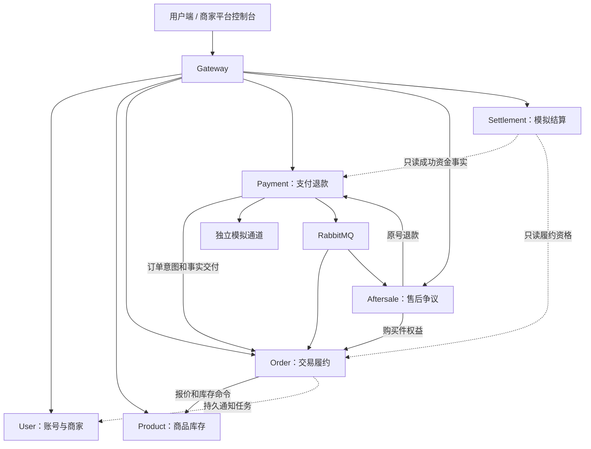

# 工程架构与当前边界

更新：2026-10-26，U1–U4及P0。源码行为见[升级说明](u1-u4-development.md)，验证以本批报告为准；旧服务器记录不代表当前源码已经部署。

## 服务边界

六个业务微服务、一个网关和一个独立模拟通道，共八个JVM。每个持久化服务访问自己的逻辑库，共七库；共享MySQL实例不允许跨服务读库。

| 服务 | 职责 | 数据和一致性边界 |
| --- | --- | --- |
| gateway | 外部路由、JWT验签、入口额度及身份头清理 | 无业务库，不执行订单或资金事务 |
| user | 账号、撤销、角色、商家入驻/成员/经营状态、地址、通知 | 全局账号权限与每商家成员职级独立；停用经营不删除历史义务 |
| product | 商品、SKU、图片、报价、库存和处置流水 | SKU全局唯一，商品归属隔离商家；缓存不是价格库存权威 |
| order | 下单Saga、交易组/子单、运费快照、履约、购买件权益 | 同库原子受理子意图，各子单独立支付、履约和售后 |
| payment | 支付退款、额度、资金账、通道协作和渠道对账 | 未知不释放额度或盲目换号；只读成功事实供结算使用 |
| aftersale | 审核、退货物流/验收/证据、争议、退款恢复协调 | 商品权益归订单、资金额度归支付；裁定不直接写资金成功 |
| settlement | 规则快照、模拟账本/批次、退款冲正/负债及本地核对 | 独立库、原事实幂等；不是真实出款 |
| payment-simulator | 独立支付退款事实、关闭墓碑、回调/账单和故障场景 | 内部受控调用，没有公开资金操作入口 |

图中不是全局事务。所有服务间查询和网络副作用在本地事务之外；唯一约束、短事务、幂等、持久任务和围栏承担恢复，不能只靠Redis锁或消息顺序保证资金库存正确。

## 多商家和金额规则

X-Merchant-Id是工作空间选择，不是授权。用户库merchant_member.role保存每店独立的ADMIN/OPERATOR；生产AuthContext.merchantRoles从有效成员权威读取，旧五参Java构造器只生成空映射，不以全局MERCHANT_ADMIN/MERCHANT_OPERATOR补权限。同一用户在A店ADMIN、B店OPERATOR时只能管理A店成员与资料；B店仅能执行操作员业务。多归属缺少选择拒绝，各服务再检查所选商家职级和资源归属。

商品及图片写、库存调整与处置、运费规则写、成员及商家资料维护需要所选商家ADMIN；订单履约、售后处置和模拟结算只读允许ADMIN/OPERATOR。平台跨店成员管理只走受控/admin专用入口。capabilities.merchantRoles保留每店职级，allowedActions聚合导航可包含任一ADMIN店铺的管理入口，不能替代当前店铺的动作权限。

用户库V7仅一次性把历史有效成员中仍有有效全局MERCHANT_ADMIN关联者回填ADMIN，其余OPERATOR。未来新增成员缺省OPERATOR，入驻审核通过创建本店ADMIN。所有成员授权和全局账号停用共享authorization_guard，禁止成员禁用/降级或全局停用账号导致某店失去最后一个可登录ADMIN；成员/职级写、目标Token撤销和审计同事务。先补授另一有效账号ADMIN再交接；历史无有效ADMIN的店由平台专用入口恢复。商家经营停用仍保留成员职级、最后ADMIN保护和历史退款义务；新经营另查商家状态。

每商家使用warehouse_main作为每个全局唯一SKU的默认逻辑库存位置，商品归属隔离商家；没有多仓调拨。交易组按商家生成独立子单，每个子单独立付款，没有一次通道付款覆盖全部商家。

金额为整数分。固定运费确认后保存规则快照，稳定分配至购买件实付，尾差前置；部分退款和退货以购买件剩余实付为权威。仅退款不增加库存，退货认可和可再售判定分离。

模拟结算冻结支付时的费率和等待期。结算前退款减少应付，结算后退款追加冲正和欠款，由后批抵扣。跨库资格查询存在并发窗口，由后续成功退款事实收敛；真实不可撤销出款需要额外清算协议，本批不提供。

## 共享代码与依赖

- common只放响应、错误、关联号等基础能力。
- contracts只放接口和事件DTO，不共享实体、Mapper或业务Service。
- common-web提供Servlet服务的发现HTTP、消息、管理安全和观测；Gateway使用WebFlux，不引入Servlet依赖。

服务调用统一通过Nacos服务名，不提供固定地址回退。RabbitMQ传输既有事件，Outbox/Inbox、延期隔离和原ID重放负责持久交接。结算资金分页周期重扫补齐自增ID提交空洞；订单通知从不可变日志反连接物化，沿原业务键交用户库去重。

## 运行与验证边界

本地启动脚本支持8080–8087和独立管理18080–18087。迁移由独立短期进程执行，业务JVM仅持所属库必要权限；新表及账本按表/列授权，密钥只保存在受保护本地配置。

验证分层执行：44项隔离MySQL/完整单应用HTTP、38项真实Nacos/RabbitMQ/Redis八服务业务链路、15项Chrome验收均通过，另有MQ专项故障演练。单应用测试关闭注册和消息，整套链路另用真实依赖，结果不能互相替代。使用临时密钥、随机回环端口和新数据目录，不复用开发或服务器业务库；详见[P0验收报告](integration/2026-10-26-p0.md)。

HTTPS、真实通道、凭据轮换、依赖高可用、容量和完整灾备另行验收。部署模板尚未按本批完成整套验收；不以健康UP代替业务验收。

P0职级规则及本地独占栈验收已完成，实际证据与生产边界以[P0报告](integration/2026-10-26-p0.md)为准；本地通过不代表已经部署或完成生产验收。
