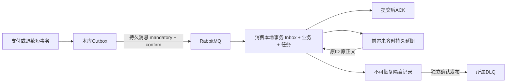

# B5 消息可靠交付与恢复

本批把支付/退款Outbox的HTTP定时交付切换为RabbitMQ，接入订单、售后和审计消费者。原内部HTTP结果接口保留，业务幂等仍适用；MQ异常时不自动走HTTP，也不把网络超时当业务失败。

## 当前链路



支付成功/失败/关闭进入订单；退款成功/失败分别进入订单与售后；OrderPaid、OrderClosed、AftersaleCompleted进入订单审计投影。审计投影只追加事实，不执行退款或库存，不是跨库财务总账。支付状态、退款额度及库存权威仍在各自数据库。

## 原子性与重复消息

事件生产与本地业务状态/流水同事务提交。发布器先短事务领取并冻结wire_payload，事务外发送；只有broker ACK且没有mandatory return才SENT。发布成功后、数据库标记前崩溃会再次发送同一事件，不能承诺exactly-once。

消息统一eventId/eventType/eventVersion/aggregateType/aggregateId/aggregateVersion/occurredAt/correlationId/causationId/traceId/payload。资金payload是完整ChannelFact；旧B3/B4的Event{eventId,fact}首次发布时兼容包装，之后按冻结字节重放。完整JSON树（含新增可选字段）规范化排序后计算摘要，同ID异内容隔离且不覆盖已接受Inbox。未知版本或类型隔离，不靠较小聚合版本丢弃独立资金事实。

消费事务包含Inbox、业务效果与后续本地任务，提交后ACK；调用既有本地支付/退款应用逻辑，不持事务做RPC。真正网络后续仍由持久任务执行。退款除事件去重外还受原来源、唯一成功退款执行号和双额度约束保护。

售后退款消息校验授权给出的原支付号、订单、来源、金额和具体尝试号。旧尝试FAILED不会覆盖新尝试；CLOSE来源合法接收后记录Inbox并忽略，不制造售后单。成功消息只唤醒原售后任务，任务确认订单授权COMPLETED（退款与库存收尾均完成）后才结束售后。

## 延期、隔离和死信的不同含义

合法但前置条件未齐的事件，先回滚失败业务，再事务持久Inbox=DEFERRED及原始正文/deferred_event后ACK。这是数据库可靠接收，不是已经转发到Rabbit重试队列。恢复器通过专用入口绕过DEFERRED去重，业务和Inbox/任务APPLIED一起提交；不能因为曾收到事件就永久跳过。

Schema、金额绑定、内容冲突等不可恢复问题保存message_failure，超限延期也隔离。原始正文、摘要、消费者和原因保留。ACK表示本库已有可靠接管；独立DLQ发送器再按原事件号和原正文向对应DLQ发布，只有confirm且无return才把发送status置SENT。disposition=QUARANTINED/RETRY_REQUESTED/RESOLVED表示业务处置，与DLQ发送状态独立。列表中尚未SENT不能称broker DLQ已收到。

数据库不可用不ACK，每次交付有限退避后NACK重入，避免快速循环。Outbox、延期及DLQ发送均30秒租约和owner/claim_version，领取即提交、完成时重验。自动恢复按5/15/60/300/900秒退避，10次或30分钟升级人工；网络旧执行者仍须依赖原编号幂等。多表消费/人工恢复统一锁序，原始证据列仅插入不授权任意改写。

## 拓扑和本机实例

专用RabbitMQ4.1.8与本机Erlang26.2.5.15兼容；不使用已有但版本不匹配的RabbitMQ4.3.2，不修改其安装。只在项目.local/tools安装官方固定release，专用节点tradeflow_local@localhost，vhost=/tradeflow。

- AMQP：127.0.0.1:5678。
- 管理页：http://localhost:15678/。
- 分布端口25678、独立EPMD43678，均回环。
- durable topic exchange：tradeflow.events；DLX：tradeflow.dlx。
- durable classic业务队列：q.order.payment、q.order.refund、q.aftersale.refund、q.order.audit；各有同名.dlq。

8种路由见docs/contracts/events-v1.schema.json：payment.succeeded.v1/payment.failed.v1/payment.closed.v1，refund.succeeded.v1/refund.failed.v1，order.paid.v1/order.closed.v1/aftersale.completed.v1。配置/绑定在业务启动前由独立管理员准备，运行账号configure=^$。payment仅发布资金路由，order仅发布订单路由且读自己的队列，aftersale仅发布售后完成路由且读自己的退款队列。消息服务不自动声明他人队列。

管理员登录凭据在受保护.local/rabbitmq-admin.json，不打印到日志；应用各自MQ账户在.local/dev-env.json。管理员/cookie/迁移与未知父进程环境变量不会传给业务JVM；启动脚本对完整环境使用明确允许清单。业务服务只有所属数据库与必要调用用途凭据。凭据文件不提交源码或指令文件。

## 运行、暂停与停止

```powershell
# 编译、迁移、准备broker拓扑后启动七个JVM，跳过测试。
.\scripts\Start-Local.ps1 -Build
# 停Java，保留MySQL和RabbitMQ数据与进程。
.\scripts\Stop-Local.ps1
# 需要停止本项目专用broker时，先停止业务，再优雅shutdown。
python scripts/Prepare-RabbitMQ.py stop
```

TRADEFLOW_MESSAGING_ENABLED=false仅暂停消息网络及恢复扫描，Outbox仍随业务追加，交付不会偷偷切换HTTP。使用此开关时业务可能等待资金结果，恢复后原ID继续处理。

Rabbit进程数据/配置/日志在.local/rabbitmq；重复prepare验证本机专用节点后复用，端口被其他实例占用拒绝接管。Docker Compose只同步模板，本轮未运行容器；原生与容器占同一组映射端口，应二选一。容器先python scripts/Prepare-RabbitMQ.py export-compose生成受保护拓扑/config，再按deploy/README操作。

## 平台消息运维接口

三个服务分别提供以下路径，统一走8080网关，直连服务也需JWT并每次复核最新PLATFORM_ADMIN：

| 所属服务 | 列表 | 原编号恢复 |
| --- | --- | --- |
| 订单 | GET /api/v1/admin/order-messages/{kind} | POST /api/v1/admin/order-messages/{kind}/{id}/retry |
| 支付 | GET /api/v1/admin/payment-messages/{kind} | POST /api/v1/admin/payment-messages/{kind}/{id}/retry |
| 售后 | GET /api/v1/admin/aftersale-messages/{kind} | POST /api/v1/admin/aftersale-messages/{kind}/{id}/retry |

kind只允许outbox/deferred/failure。列表page从1开始、pageSize最多100，只返本库处置元数据；id分别event_id/deferred_id/failure_id，响应中可获得。恢复body为必填reason（1–1000字），与操作者审计同事务。禁止编辑正文、换事件ID绕过去重或手工设置资金成功。

outbox允许原ID重发，仍会复核资金人工冻结标记。已应用延期无需重放。failure若DLQ发送处于MANUAL_REVIEW，先恢复DLQ发送，响应target=dlq；否则校验原文契约与Inbox绑定，将原文交到延期业务恢复，target=deferred。同ID异内容或仍不合法的Schema不能修改后强制执行。已经在broker DLQ中的证据保留，不通过随意消费清空来掩盖异常。

## 迁移与验证边界

订单新增V5、支付V3、售后V2；旧迁移不改写。三库新增Inbox/延期/隔离/操作审计，订单/售后新增Outbox，支付追加wire_payload；订单新增只追加event_projection，售后追加原支付授权绑定列。实际表数和COMMENT、构建/启动/队列元信息见verification.md。

本轮不测试、不发送模拟交易或人工故障消息。编译、迁移、健康UP、消费者连接和拓扑存在只能证明各自检查，不证明确认丢失、乱序、并发、DLQ或重启恢复场景已跑通；单节点classic broker没有多副本高可用证据。TLS、服务凭据轮换、监控告警面板及B8故障/备份/压测仍待后续验收。
