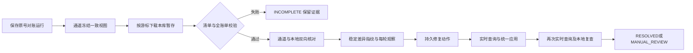

# B7 冻结账单、双向对账与差异恢复

本批实现开发资料01第12节及06的B7，沿用支付、退款统一结果应用器和B5可靠消息。当前为代码实现与本机启动交付；按用户要求没有运行测试、业务演示请求、对账造差、并发、故障注入或压测。

## 对账流程与完整性门禁



账期统一UTC半开区间`[start,end)`，最多31天，输入最多毫秒精度。结束后至少留5分钟：`end + 300秒 <= cutoff <= 当前时间`。这段宽限不能保证未来不再出现迟到变更；每日UTC 00:10按稳定系统命令重扫最近三个完整日账期，每日分别生成三个运行。首次启动不会主动制造对账运行。

模拟通道独立库在同一REPEATABLE_READ事务内，按支付、退款及业务号顺序读取账期内的可见终态。每批500条，冻结头与全部明细同事务提交，位置从1连续。原请求号绑定区间、币种与截止点，同号异参409，同号重试返回同一快照；不会从实时列表临时拼页。超过100000行整笔拒绝回滚，需缩小账期，不截断后冒充完整账单。

清单包含快照号、请求号、SIMULATOR通道、币种、区间、cutoff、水位、COMPLETE状态、支付/退款记录数、成功金额汇总、SHA256。支付含SUCCEEDED/FAILED/CLOSED，退款含SUCCEEDED/FAILED；计数包括所有终态，金额汇总只累计成功事实。摘要采用共享`ReconciliationContracts.canonical`的固定字段、空值标记和UTF8长度前缀编码，不依赖JSON键顺序。

支付先保存下载行及游标，随后流式校验清单绑定、水位、页连续性、排序、重复业务号、类型、终态、时间范围、计数、金额和总摘要。**全部校验通过前不创建业务差异，也不启动资金修复。**不完整清单、错摘要、缺页或截断进入INCOMPLETE并保留原证据，必须新建运行重新冻结，不能人工改成完整。

## 差异与安全处置

| 情况 | 处理 |
| --- | --- |
| 通道终态、本地非终态且绑定一致 | 实时重查后，经统一结果应用器推进，写额度、唯一流水与Outbox |
| 本地成功、唯一流水缺失且额度完整 | 受控补记锁定的当前成功事实，不再次转换退款额度 |
| 通道有记录、本地无业务 | CHANNEL_ONLY，人工核查来源，禁止凭账单造订单或支付 |
| 本地处理中、通道实时404 | 保留未决，不当FAILED，不释放资金；原任务及人工动作仍保留 |
| 完整账单缺失、本地有事实 | 先实时查询，不能仅凭缺失回滚已成功业务 |
| 金额、币种、订单、原支付或来源冲突 | 冻结相关支付自动推进，转人工，不覆盖终态 |
| 相反终态或不可变通道编号/成功时间矛盾 | 即使旧版本也保留严重冲突并冻结 |
| 查询读到旧非终态，回调已推进本地成功 | LIVE_STALE，保留人工复查，不因正常交错误冻结 |
| 内部退款本金/来源汇总、明细或流水不一致 | 记录完整性差异并冻结，不静默重算余额 |

双向扫描不仅检查通道账单，也检查本地账期内变化，以及cutoff前所有PENDING/PROCESSING/UNKNOWN项。旧未决不会因最近三天窗口滚动而被删除。累计检查比较本库refund_account、refund_source与逐笔执行的成功/未决金额、当前执行号和关联；通道侧逐笔绑定与金额通过账单及实时事实核对。支付服务不跨库扫描库存，库存仍由订单/商品的权益与独立回补协议保证。

差异指纹为`SHA256(channel|transactionType|businessNo|issueType)`。重复运行复用问题号，每个运行保存独立、不可变的观察；同轮恢复不覆盖第一份观察。已解决问题再次出现会重新打开。动作先持久化，QUERY阶段实时查询、围栏事务内重读资金并安全应用，下一独立RECHECK阶段再次实时查询和本地核对，附动作号与证据后才RESOLVED；没有无证据“点击已处理”的接口。

运行SUCCEEDED只表示扫描完成，不代表全部差异已解决。运行详情`statistics`包括观察差异数、来源动作数、复查通过数、实际应用且复查通过的修复数及创建到最近持久进度的耗时。纯匹配复查不计为修复；统计来自持久观察/动作，不预写性能数字。

## 平台接口

通过网关 http://localhost:8080 访问，Bearer令牌必须为最新有效平台管理员。所有写命令要求`Idempotency-Key`，ASCII最多64字符，以及1–500字符原因；同主体、操作、键绑定原参数、原因与结果号。

| 方法与路径（前缀/api/v1/admin/reconciliation） | 用途 |
| --- | --- |
| POST /runs | 指定账期创建持久运行 |
| GET /runs | page/pageSize分页，最大100 |
| GET /runs/{runNo} | 运行状态、payload检查点、清单和statistics |
| POST /runs/{runNo}/retry | 仅人工状态，原号原快照继续；INCOMPLETE需新运行 |
| GET /runs/{runNo}/observations | 本轮不可变观察 |
| GET /issues | 稳定差异分页 |
| GET /issues/{issueNo} | 当前处置状态与动作指针 |
| GET /issues/{issueNo}/observations | 同一问题跨轮证据 |
| POST /issues/{issueNo}/repair | 排队实时核验与受控修复，已有活动动作返回原号 |
| GET /actions/{actionNo} | 动作阶段、证据、结果及是否实际应用 |
| POST /actions/{actionNo}/retry | 原人工动作恢复；同差异有其他活动动作时409 |
| POST /checks | 按原业务号定向核验与受控恢复，不重新提交支付/退款 |

创建请求示例（仅文档，未发送）：

```json
{
  "start":"2026-10-22T00:00:00Z",
  "end":"2026-10-23T00:00:00Z",
  "cutoff":"2026-10-23T00:05:00Z",
  "reason":"核对指定UTC账期的支付与退款"
}
```

修复/重试请求为`{"reason":"已核对依赖状态，按原编号继续"}`。定向核验为`{"type":"PAYMENT","businessNo":"pay_...","reason":"查询原支付权威结果并恢复"}`，类型也可REFUND。定向核验可以推进满足条件的本地事实或补唯一流水；不会再次请求扣款、退款，不会自动解除人工冻结。

响应200/202只表示读取或持久受理。平台记录返回`task_no/state/payload`等字段，payload为检查点/证据JSON字符串；详情应解析phase、manifest、actor、reason和outcome。run状态READY/RUNNING/SUCCEEDED/INCOMPLETE/MANUAL_REVIEW，issue状态OPEN/VERIFYING/REPAIRING/RESOLVED/MANUAL_REVIEW。动作只有复查通过才SUCCEEDED。

## 内部账单接口及开发投影

以下不经公开网关，均校验payment调用方及独立channel凭据：

- `POST /channel/v1/bill-snapshots`：BillRequest `{requestNo,start,end,cutoff,currency:"CNY"}`。
- `GET /channel/v1/bill-snapshots/{snapshot}`：冻结清单。
- `GET /channel/v1/bill-snapshots/{snapshot}/lines?after=0&pageSize=100`：稳定位置游标，最大100。

开发环境专用`POST /simulator-admin/v1/bill-projections`，独立管理令牌与dev环境同时成立才允许。参数`{requestNo,mode,actorId,reason}`，模式INCOMPLETE、BAD_CHECKSUM、TRUNCATED_PAGE；首次冻结前一次绑定，不影响真实支付退款事实，不能在正常账单冻结后改写投影。正常路径自动绑定NONE。原目标`/channel/v1/bills`被实际bill-snapshots协议替代。

本轮没有调用投影、创建账单、发起对账或修复业务接口，没有构造业务数据。投影故障与修复效果只是实现能力，尚未执行场景验收。

## 事务、恢复与权限

任务领取独立短事务，不锁资金表；每步30秒租约、owner、claim_version与到期检查。远程调用发生在事务外；action事务先验证围栏，再按支付→账户→来源→退款锁序检查资金，提交前再验证租约，过期整笔回滚。正常进度清零连续失败预算，最多30次依赖异常转人工；关联差异同步人工状态。旧动作只能在当前问题指针仍指向自己时回写状态。

同差异只有一个活动修复动作。人工恢复先锁原动作再锁差异，拒绝其他活动动作；新修复命令锁差异后只读已有动作，不反向锁正在执行的动作。恢复保持原动作/请求/快照，不改账单、金额、通道事实或资金终态。已发出的副作用无法撤回，冻结只阻止后续自动推进及尚未发送事件，仍依赖通道终态协议与下游幂等。

新增支付V4六表：run、stage_line、issue、observation、action、command；模拟器V3三表：bill_snapshot、bill_snapshot_line、bill_projection_scenario。新增9张业务表后六库为7/15/23/20/12/15，共92张，另六张Flyway历史表。所有表字段有中文COMMENT，旧已执行迁移未改写。

观察、下载行与账单行仅SELECT/INSERT；平台命令原参数、原因只追加，仅允许首次填充result_no。任务仅必要状态/检查点列UPDATE，差异指纹与业务绑定无UPDATE权限；账头仅允许首次清单填充和幂等无操作列，场景仅幂等无操作列。账本/审计仍不可修改或删除。迁移凭据不进入业务JVM。

本机运行仍用`scripts/Start-Local.ps1 -Build`，跳过测试；MySQL、RabbitMQ与七个JVM保留运行。Docker部署、驱动流式行为、大账单耗时、租约并发、资金与造差恢复场景尚未验收，不能从构建、迁移或健康UP推导通过。后续B8补可观测性与交付验收，是否开展测试仍遵照用户指令。
